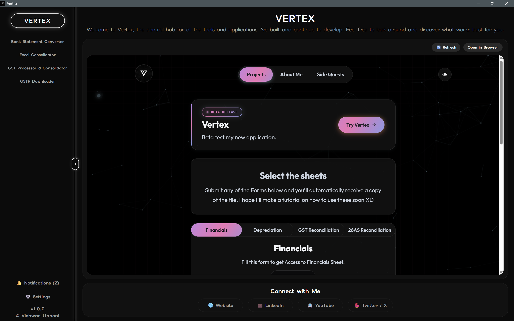
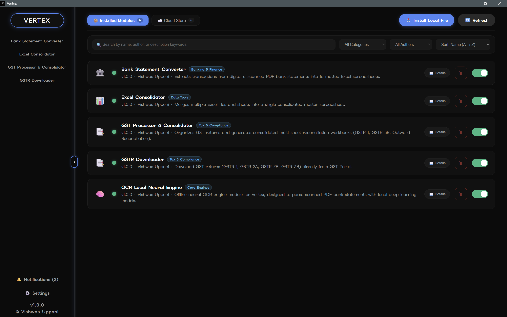
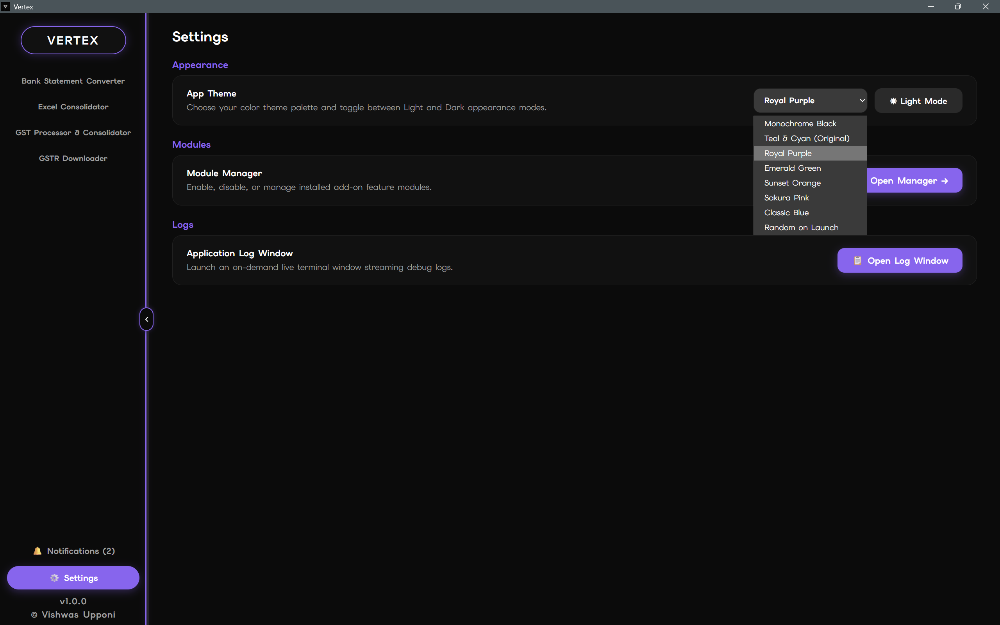
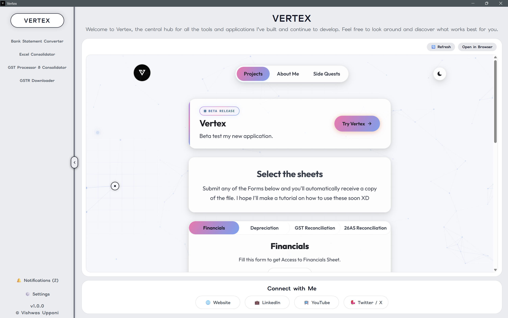

# Vertex Application

[](https://github.com/vishwasupponi/vertex-shell/releases)
[](LICENSE)
[](https://www.microsoft.com/windows)
[](https://developer.microsoft.com/en-us/microsoft-edge/webview2/)

> A portable, privacy-first desktop platform. Lightweight by design, endlessly extensible through modules.

Vertex is a modular, lightweight, portable, privacy-focused app. By itself, Vertex is just a host that can load different modules designed for different uses. Since the app is modular, you can install any module you want without having to download everything.

Visit my [website](https://vishwasupponi.blogspot.com) for more information.

> [!NOTE]
> **Internet Usage**: Uses an internet connection to load the developer website embedded on the Home dashboard, and inside Module Manager to browse the store catalog, check for updates, and download modules. All other shell operations run completely offline.

---

## 📸 Screenshots

### Home Dashboard


### Module Manager


### Settings


### Appearance & Themes



---

## ✨ Key Features

- **🛡️ Zero-Telemetry Policy**: Vertex contains zero telemetry, zero analytics trackers, zero usage logging, and zero background call-homes.
- **🧩 Decoupled Modular Ecosystem**: Tools and parsers are distributed as isolated `.vtx` addon modules. Each addon operates within its own encapsulated namespace and self-contained tree.
- **🎨 Modern WebView2 Shell**: A desktop interface built on Microsoft Edge WebView2, delivering a responsive, modern user experience with customizable appearance modes and smooth navigation.
- **📁 Self-Contained Local Storage**: All files, settings, and installed plugins required by Vertex are stored strictly within the application folder itself (inside the `UserData/` directory for plugins). No files or directories are created outside this folder unless you explicitly choose to save exported output files elsewhere.

---

## 📦 Official Addon Suite

Vertex features an integrated **Module Manager** that allows users to discover, install, update, and manage modular extensions in a single click.

For the list of official modules and their respective repositories, see [modules.json](modules.json).

---

## 🖥️ System Requirements

| Requirement | Details |
| :--- | :--- |
| **OS** | Windows 10 (Version 1903 or later) or Windows 11<br>Type: 64-bit (x86-64 / AMD64) |
| **Processor** | Intel 4th Gen Core or AMD equivalent (Requires AVX2 and SSE4.2 support) |
| **RAM** | • **Minimum**: 4 GB (adequate for the core shell, Excel Consolidator, GSTR Processor, and GSTR Downloader)<br>• **Recommended**: 8 GB (strongly recommended when using the local neural OCR engine for scanned statements) |
| **Storage** | • **App**: ~150 MB Extracted<br>• **Addon Modules**: Varies according to modules installed.<br>• **Recommended Free Space**: 1.5 GB – 2 GB baseline (actual space required increases as additional modules and export files are added). |
| **Display** | • **Minimum**: 1280 × 720 (HD)<br>• **Recommended**: 1920 × 1080 (Full HD) |

---

## 🚀 Getting Started

### Running the Desktop Application
Vertex is 100% portable—no installer wizard or administrator privileges are required:
1. Download the latest release package from the [Releases](https://github.com/vishwasupponi/vertex-shell/releases) page.
2. Extract the archive into your preferred folder.
3. Launch `Vertex.exe`.
4. Click **Settings** in the left navigation sidebar and open **Module Manager** to browse available modules or install local `.vtx` modules.

### Running from Source (Developer / Security Audit)
Vertex source code is published openly to enable independent security verification and auditing:

```powershell
# Clone the shell repository
git clone https://github.com/vishwasupponi/vertex-shell.git
cd vertex-shell

# Install base runtime dependencies (Python 3.12 64-bit required)
pip install pywebview bottle requests cryptography

# Launch the developer application shell
python main.py
```

---

## 🤝 Contributing & Security

- You are free to develop custom plugins for personal use. To propose a module for the official Cloud Store catalog or submit contributions, see [CONTRIBUTING.md](CONTRIBUTING.md).
- To report a security concern or review the security policy, see [SECURITY.md](SECURITY.md).

---

## 🙏 Acknowledgments

Vertex is built using various open-source libraries and components under their respective open-source licenses. Building Vertex would not have been possible without these foundational open-source technologies, and I thank all the original developers and maintainers of these projects for their contributions:

- **[pywebview](https://pywebview.flowrl.com/)** – Native cross-platform desktop windowing shell and WebView2 host.
- **[pythonnet](https://pythonnet.github.io/)** – Windows CLR runtime integration for the Microsoft Edge WebView2 control.
- **[Requests](https://requests.readthedocs.io/)** – HTTP networking for Module Manager catalog updates.
- **[cryptography](https://cryptography.io/)** – Cryptographic verification and secure hashing.

---

## 📄 License

This project is licensed under the [GNU Affero General Public License v3 (AGPL-3.0)](LICENSE).

Developed by [Vishwas Upponi](https://vishwasupponi.blogspot.com/links).
